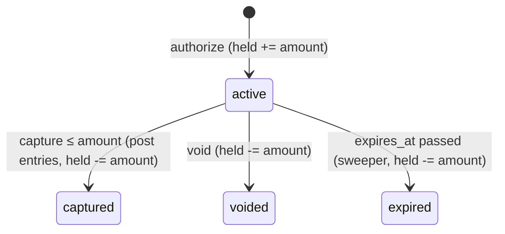

# ledger

[](https://github.com/danchetin/ledger/actions/workflows/ci.yml)

A double-entry ledger service in Go on PostgreSQL: accounts, multi-leg transfers,
holds (authorize / capture / void / expire), reversals, idempotent writes, account
statements and a reconciliation check that re-derives every balance from the journal.

The point of the project is correctness under concurrency. Money is never created or
lost, an account without overdraft never goes negative, a retried request never posts
twice, and all of this holds with hundreds of clients writing at once. Each of those
properties is enforced in the code, enforced again by the database, and checked by tests
that hammer the service concurrently and compare it against a model.

```text
client ──HTTP──► api (Idempotency-Key, validation, errors, metrics)
                  │
                  ▼
                ledger service ── one DB transaction per request ──► PostgreSQL
                  │   lock accounts in id order (SELECT … FOR UPDATE)     │
                  │   check balances, post entries, update balances       ├─ CHECK / FK constraints
                  │   store idempotent response                           ├─ deferred "sum = 0" trigger
                  ▼                                                       └─ append-only triggers
                reconcile (read-only snapshot: journal vs balances)
```

## Quick start

```bash
docker compose up --build        # API on :8080 + PostgreSQL, migrations run on start
```

```bash
# Accounts. The "world" account may go negative: it is where deposits come from.
curl -s localhost:8080/v1/accounts -d '{"name":"world","currency":"USD","allow_overdraft":true}'
curl -s localhost:8080/v1/accounts -d '{"name":"alice","currency":"USD"}'
curl -s localhost:8080/v1/accounts -d '{"name":"bob","currency":"USD"}'

# Transfers move integer minor units (cents) and require an Idempotency-Key.
curl -s localhost:8080/v1/transfers -H 'Idempotency-Key: deposit-1' \
  -d '{"from_account_id":"<world>","to_account_id":"<alice>","amount":10000}'

# Retrying with the same key and body replays the stored response
# (Idempotent-Replayed: true); nothing is posted twice.
curl -si localhost:8080/v1/transfers -H 'Idempotency-Key: deposit-1' \
  -d '{"from_account_id":"<world>","to_account_id":"<alice>","amount":10000}'

# Split payment: legs must sum to zero per currency.
curl -s localhost:8080/v1/transfers -H 'Idempotency-Key: order-1042' -d '{"legs":[
  {"account_id":"<alice>","amount":-1000},
  {"account_id":"<bob>","amount":970},
  {"account_id":"<fees>","amount":30}]}'

curl -s localhost:8080/v1/accounts/<alice>            # balance, held, available
curl -s localhost:8080/v1/accounts/<alice>/entries    # statement with balance_after
curl -s localhost:8080/v1/reconcile                   # {"ok":true, ...}
```

The full API is described in [`internal/api/openapi.yaml`](internal/api/openapi.yaml),
also served at `GET /openapi.yaml`.

## API

| Method & path | What it does |
|---|---|
| `POST /v1/accounts` | Create an account in one currency (optionally with overdraft) |
| `GET /v1/accounts`, `GET /v1/accounts/{id}` | List (cursor pagination) / get with `balance`, `held`, `available` |
| `GET /v1/accounts/{id}/entries` | Statement, newest first, each entry with `balance_after` |
| `POST /v1/transfers` | Simple transfer or multi-leg transaction (up to 50 legs) |
| `GET /v1/transactions/{id}` | Transaction with its entries |
| `POST /v1/transactions/{id}/reverse` | Post the opposite transaction (once) |
| `POST /v1/holds` | Authorize: reserve money until capture, void or expiry |
| `POST /v1/holds/{id}/capture` | Capture all or part; the remainder is released |
| `POST /v1/holds/{id}/void` | Release the reservation |
| `GET /v1/reconcile` | Re-derive balances from the journal and report mismatches |
| `GET /healthz`, `GET /readyz`, `GET /metrics` | Liveness, readiness (DB ping), Prometheus |

Endpoints that move money (`transfers`, `reverse`, `holds`, `capture`, `void`) reject
requests without `Idempotency-Key`. Errors look like
`{"error":{"code":"insufficient_funds","message":"..."}}` with stable codes:
`validation_error` (400), `not_found` (404), `hold_not_active` / `hold_expired` /
`already_reversed` (409), `insufficient_funds` / `currency_mismatch` /
`unbalanced_transaction` / `idempotency_key_reused` (422).

## How correctness is enforced

**1. The service.** Every request is one database transaction. Before writing, the
service locks the involved account rows (`SELECT … FOR UPDATE`), checks that the legs
sum to zero per currency and that no non-overdraft account's *available* balance
(`balance - held`) would drop below zero, then writes the transaction, its entries and
the new balances.

**2. The database**, so a bug in the service cannot corrupt the books
([`0001_init.sql`](internal/db/migrations/0001_init.sql)):

- a deferred constraint trigger rejects, at `COMMIT`, any transaction whose entries do
  not sum to zero per currency, or that has fewer than two entries;
- `FOREIGN KEY (account_id, currency) REFERENCES accounts (id, currency)` makes an entry
  in the wrong currency impossible;
- `CHECK (allow_overdraft OR balance - held >= 0)` on accounts;
- triggers make `transactions` and `entries` append-only: mistakes are corrected with a
  reversal, never by editing history.

A test writes broken rows with raw SQL and checks that each one is refused.

**3. Reconciliation.** `GET /v1/reconcile` (and `ledger reconcile`, which exits 1 on
problems) reads one `REPEATABLE READ` snapshot and checks that every balance equals the
sum of its entries and the `balance_after` of its latest entry, that `held` equals the
active holds, that every transaction balances, and that each currency sums to zero
across all accounts. Every test ends with it.

## Design decisions and trade-offs

**Integers, not floats.** Amounts are `int64` minor units; overflow is checked on every
addition.

**Pessimistic row locks in a fixed order.** Accounts are always locked in ascending id
order, in one statement, so two transactions that touch the same accounts queue up
instead of deadlocking. `READ COMMITTED` plus explicit locks is enough: the rows that
matter are locked, and `SERIALIZABLE` would add aborts without adding safety here.
Deadlocks or serialization failures that do happen (for example from manual SQL) are
retried with jittered backoff.

**Cached balances plus an append-only journal.** Each account stores its current
`balance` and `held`, so a balance read is one row and a balance check needs no
aggregation. The journal stays the source of truth: reconciliation proves the cache
matches it, and every entry keeps `balance_after` for cheap, auditable statements.

**Holds reserve money without moving it.** Authorizing increases `held` and lowers
`available`; capture posts a real transaction and releases the hold; void and expiry
only release. Expiry runs in the background with `FOR UPDATE SKIP LOCKED`, so it never
blocks a capture in progress.



**Idempotency in the same transaction as the effect.** The key row is inserted at the
start of the request's transaction and its response is stored right before `COMMIT`,
so the effect and the stored response commit together or not at all:

```mermaid
sequenceDiagram
    participant A as request A
    participant B as retry B (same key)
    participant DB as PostgreSQL
    A->>DB: BEGIN; INSERT key ON CONFLICT DO NOTHING (1 row)
    B->>DB: BEGIN; INSERT key ON CONFLICT DO NOTHING
    Note over B,DB: waits on A's uncommitted row
    A->>DB: post transfer; UPDATE key SET response; COMMIT
    DB-->>B: conflict, 0 rows
    B->>DB: SELECT stored response → replay, nothing posted
```

The key is bound to a SHA-256 of method, path and body, so reusing a key for a different
request is an error instead of a silent replay. Business failures (for example
insufficient funds) are stored and replayed too, after a `SAVEPOINT` rollback removes
any partial effects; internal errors roll back the key as well, so the client can retry.
Keys are purged after `IDEMPOTENCY_TTL`.

**PostgreSQL only.** No Redis or queue: locks, idempotency, expiry and invariants all
live in one transactional store, which keeps every guarantee atomic.

## Performance

Measured with [`cmd/loadtest`](cmd/loadtest/main.go): random transfers between 100
accounts over HTTP, each with a fresh `Idempotency-Key`, followed by a conservation check
and a full reconciliation (both passed in every run, with zero 5xx).

| Clients | Transfers/s | p50 | p95 | p99 |
|---:|---:|---:|---:|---:|
| 8 | 1,867 | 3.7 ms | 7.2 ms | 10.8 ms |
| 32 | 2,825 | 9.1 ms | 22.9 ms | 35.8 ms |
| 64 | 2,708 | 21.0 ms | 37.2 ms | 66.9 ms |

Setup: one Apple M4 (10 cores, 16 GB) running the load generator, the service
(`DB_MAX_CONNS=32`) and PostgreSQL 16 in Docker (OrbStack) with durable settings
(`fsync=on`, `synchronous_commit=on`). Throughput levels off around 32 clients, where
the connection pool and commit latency are the limit; more clients only add queueing.

Contention: when half of all transfers involve the same account (`-hot 0.5`), requests
on that account serialize on its row lock. The service still handled 2,415 requests/s,
p99 grew to 77 ms, and the books stayed exact. A production system with a very hot
account (a platform fee account, say) would split it into several sub-accounts; this
project does not do that.

These are numbers from a laptop, not a capacity plan; rerun them on your hardware with
`make loadtest`.

## Tests

```bash
make db test          # Postgres on :55432, then go test -race ./...
```

Tests run against a real PostgreSQL: each test gets its own freshly migrated database.
They cover, among others:

- **Concurrency:** 32 workers × 100 random transfers between 10 accounts; money is
  conserved, nothing goes negative, the journal reconciles.
- **Holds race:** 50 concurrent holds of 100 against 1,000 available → exactly 10
  succeed; then captures, voids, transfers and the expiry sweeper run concurrently.
- **Idempotency:** 50 concurrent requests with one key post once and get identical
  responses; also over HTTP; key reuse with a different body is rejected; stored errors
  leave no partial effects; internal errors are not stored.
- **Model-based test:** a random sequence of transfers, multi-leg transfers, holds,
  captures, voids and reversals; after every step the database must equal a simple
  in-memory model. The seed is logged; replay with `LEDGER_PROPERTY_SEED=<seed>`.
- **Database guards:** unbalanced, wrong-currency, overdrawn and edited rows written
  with raw SQL are rejected by PostgreSQL itself.
- **HTTP:** full flow, error mapping, auth, metrics labels, pagination.

Coverage of `internal/...` is about 78%.

## Configuration

| Variable | Default | Meaning |
|---|---|---|
| `DATABASE_URL` | (required) | PostgreSQL connection string |
| `LISTEN_ADDR` | `:8080` | HTTP address |
| `LEDGER_API_KEY` | (empty) | If set, `/v1/*` requires `Authorization: Bearer <key>` |
| `DB_MAX_CONNS` | `20` | Connection pool size |
| `AUTO_MIGRATE` | `true` | Apply migrations on start (guarded by an advisory lock) |
| `SWEEP_INTERVAL` | `30s` | How often expired holds are released and old keys purged |
| `IDEMPOTENCY_TTL` | `24h` | How long stored responses are kept |
| `LOG_LEVEL` | `info` | `debug`, `info`, `warn`, `error` (JSON logs) |

Commands: `ledger serve` (default), `ledger migrate`, `ledger reconcile`, `ledger version`.

## Project layout

```text
cmd/ledger          service entry point: serve, migrate, reconcile
cmd/loadtest        HTTP load generator with conservation + reconciliation checks
internal/ledger     domain logic: locking, posting, holds, reversals, idempotency, reconcile
internal/api        HTTP handlers, middleware, metrics, OpenAPI spec
internal/db         pool setup and embedded SQL migrations
internal/testdb     per-test database helper
```

## Limitations

- One API key, no multi-tenancy or per-client permissions.
- No currency conversion rates: an exchange is expressed as a four-leg transaction, the
  rate is the caller's business.
- Hot accounts are not sharded (see Performance).
- No outbox or event stream for downstream consumers yet.
- Reconciliation scans everything; fine for this scale, a real system would do it
  incrementally.
- Append-only triggers stop `UPDATE` and `DELETE`, not `TRUNCATE` or a superuser.

## License

MIT
